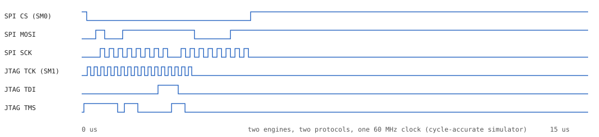

    

# Bitweaver: a programmable protocol emulator

Bitweaver is a Tiny Tapeout chip (IHP SG13CMOS5L, 8x4 tiles, 60 MHz) with no fixed UART, SPI or I2C hardware.
Two small engines run bit-banging programs with exact cycle timing, and a handful of generic primitives
(open-drain pads, a WAIT with timeout, a bit-level assist unit for NRZI, Manchester, bit stuffing and CRCs, a
timestamp, FIFO chaining) let firmware speak protocols the chip was never designed around.

**Protocols running in firmware**, each tested against an independent model of the other end of the wire:

| | | |
|---|---|---|
| UART (9600–921600 baud, 8N1/8E1) | SPI controller modes 0–3, SPI target | I2C controller (100/400 kHz) and target |
| WS2812 LEDs | JTAG | SWD (Arm debug) |
| PS/2 | CAN 2.0A (500 kbit/s, 1 Mbit/s) | low-speed USB packets |
| 1-Wire | SPI and I2C at the same time | |



*Two engines, two protocols, one 60 MHz clock: an SPI frame and a JTAG IR scan (rendered from the cycle-accurate
simulator by `scripts/wave_svg.py`; the RTL matches it on every cycle).*

## Documentation

* [Architecture](docs/architecture.md): block diagram, engines, host port, design decisions
* [Instruction set](docs/isa.md) and [register map](docs/regmap.md)
* [Programming guide](docs/programming_guide.md): writing a new protocol (1-Wire) from scratch
* [Verification](docs/verification.md): lock-step against a cycle-accurate model, random testing, formal proofs,
  coverage, independent protocol models
* [Results](docs/results.md): area, timing, protocol speeds
* [Datasheet page](docs/info.md) for the Tiny Tapeout shuttle
* [How AI was used](docs/ai_usage.md)

## Repository

| Path | Contents |
|---|---|
| `src/` | RTL: `project.v` (top), `bw_sm.v` (engine), `bw_bau.v`, `bw_fifo.v`, `bw_clkdiv.v`, `bw_imem.v`, `bw_host_spi.v`; `bw_defs.vh` is generated |
| `sw/bitweaver/` | Python toolchain: register map (single source of truth), assembler, loader, cycle-accurate simulator, protocol helpers |
| `sw/programs/` | protocol programs (`.bw`) |
| `sw/host/micropython/` | driver for the Tiny Tapeout demo board |
| `test/` | cocotb tests: every test runs the RTL in lock-step with the simulator; `test/lib/` holds the protocol models |
| `verif/lockstep/` | constrained-random lock-step (Verilator) and coverage |
| `formal/` | SymbiYosys proofs |
| `scripts/` | area estimate against the IHP cell library |

## Quick start

```bash
source ~/tools/oss-cad-suite/environment                  # iverilog, verilator, yosys, sby, cocotb
make -C sw test                                           # toolchain unit tests
(cd sw && python3 -m bitweaver.asm programs/uart.bw)      # assemble and list a program
make -C sw programs                                       # all programs to sw/build: .json, .hex, .lst
cd test && make && python3 -m cocotb_tools.check_results results.xml   # RTL tests, in lock-step
```

A UART transmitter is four instructions:

```
.program uart_tx
.side_set 1 opt
    pull               side 1 [7]   ; stop bit, or idle while the FIFO is empty
    set x, DATA_BITS-1 side 0 [7]   ; start bit
bitloop:
    out pins, 1                     ; one data bit ...
    jmp x-- bitloop          [6]    ; ... held for 8 ticks
```

## License

Apache 2.0. Built from the [Tiny Tapeout IHP Verilog template](https://github.com/TinyTapeout/ttihp-verilog-template).
