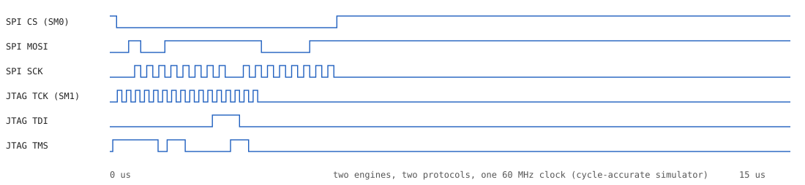
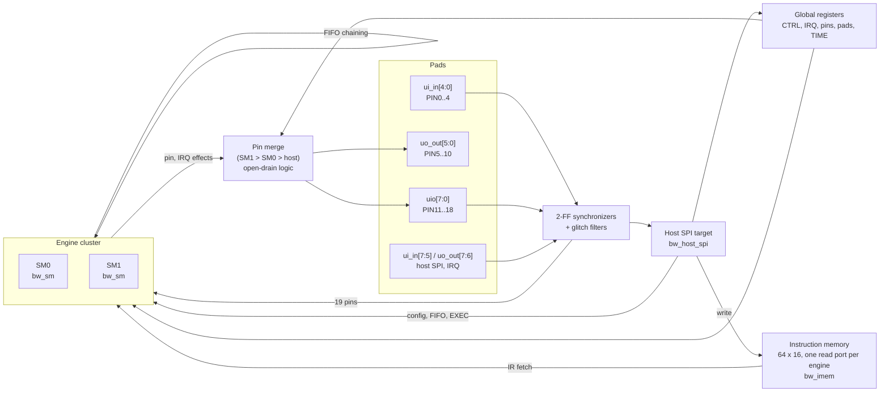

# Bitweaver architecture

Bitweaver is a programmable protocol emulator for Tiny Tapeout (IHP SG13CMOS5L, 8x4 tiles, 50 MHz). It has no
UART, SPI or I2C hardware. Two small engines execute bit-banging programs with exact cycle timing, and a few
generic helpers (open-drain pads, a timed WAIT, a bit-level assist unit, a timestamp, FIFO chaining) make protocols
that would otherwise need dedicated hardware possible in firmware.

The specification of the instruction set is [isa.md](isa.md), the register map is [regmap.md](regmap.md) (generated
from `sw/bitweaver/regmap.py`), and [programming_guide.md](programming_guide.md) walks through writing a new
protocol.



## Block diagram



Each engine (`bw_sm`) contains:

```
            +-------------------------- bw_sm ---------------------------+
 config --> | CLKDIV ─> bw_clkdiv ─> tick                                 |
 regs       | PC, IR (= imem[PC], or an injected instruction)             |
            | decode/execute ── X, Y, delay, WAIT timeout counter         |
 pins[31:0] | OSR <── TX FIFO ──┐   bw_fifo: 8 x 16 shared, 4+4 or 8+0 |
 (19 real + | ISR ──> RX FIFO ──┘   (join TX / join RX)                 |
 13 virtual)| bw_bau: NRZI, bit stuffing, Manchester, CRC LFSR            |
            +---> pin set/clear masks, IRQ set/clear, FIFO status --------+
```

## Pins

| Pins | Pads | Notes |
|---|---|---|
| PIN0..PIN4 | `ui_in[4:0]` | input only |
| PIN5..PIN10 | `uo_out[5:0]` | output only; engines read back the driven level |
| PIN11..PIN18 | `uio[7:0]` | bidirectional, optional open drain, TT Pmod conventions (SPI, UART, I2C) |
| host | `ui_in[7:5]`, `uo_out[7:6]` | `HOST_CS_N`, `HOST_SCK`, `HOST_MOSI`, `HOST_MISO`, `HOST_IRQ` |

Every input passes a 2-flip-flop synchronizer. The 13 protocol inputs also have an optional glitch filter
(`PAD_FILT`): the filtered level only changes after the synchronized input has agreed for three consecutive
cycles, which removes pulses shorter than three clock cycles (60 ns at 50 MHz) at the cost of three more cycles of
latency.

Every output pin has a level bit (`PIN_OUT`) and an enable bit (`PIN_OE`). The host writes them directly; engines
change them with `OUT`/`MOV`/`SET PINS`/`PINDIRS` and side-set. All writers of a cycle are merged with a fixed
priority (SM1 > SM0 > host), so a write never needs a read-modify-write.

Disabling or restarting an engine keeps its pins driven and its pad modes set: the pin registers are global,
not per engine. Handing pins to another program therefore means releasing them and then clearing the open-drain
and filter bits nobody needs; the loaders do this whenever a program replaces another on an engine
(`bitweaver.loader.PinOwners`). A pin the new program sets up itself is not released in between, so reloading
an engine does not glitch its lines. After reset, PIN5..PIN10 are dedicated outputs driving 0 (they have no
output enable, so "released" would mean driving 0), and PIN11..PIN18 are released.

In **open-drain mode** (`PAD_OD`, PIN11..PIN18) the pad's output value is forced to 0 and the level bit only
controls the enable: level 0 pulls the line low, level 1 releases it. An open-drain pin can never drive high;
this is proved formally (`formal/opendrain.sby`). I2C, 1-Wire, PS/2 and clock stretching all rely on it.

## Host port

`bw_host_spi` is an SPI mode 0 target clocked by the system clock. SCK, MOSI and CS_N are synchronized and
edge-detected, so SCK high and low times must each be at least three clock cycles for writes. Reads need more:
MISO changes two to three cycles after the synchronized SCK falls, and the host samples it at the next rising
edge, so the SCK low time must exceed three cycles plus every cycle that the pads, the Tiny Tapeout multiplexer
and SCK's phase against the chip clock add. **On real hardware run SCK at clk/16 or slower** (about 3 MHz at
50 MHz), which leaves four cycles (80 ns) for those delays. At clk/8 the margin is zero: reads work with ideal
pads but shift by one bit with a single cycle of delay (`sw/tests/test_clock_and_host_timing.py` checks both, with
`SpiDriver(miso_delay=...)` modelling the delay).

```
CS_N  ‾‾\__________________________________________________________/‾‾
MOSI      [ cmd: W I . . . . . . ][ addr ][ data word 15..0 ][ word ]...
MISO      [ ID 0xB7             ][ status ][ read data      ][ ...  ]
```

* `cmd[7]` = 1 for a write, `cmd[6]` = 1 to auto-increment the address after every word.
* While the command byte is shifted in, MISO returns the ID byte `0xB7`; during the address byte it returns a FIFO
  status byte (bit *n*: TX FIFO *n* not full, bit 4+*n*: RX FIFO *n* not empty), so a host can poll all FIFOs
  with a two-byte frame.
* A write takes effect about four clock cycles after the SCK rising edge of its last data bit (two cycles of
  synchronizer, one to detect the edge, one registered write strobe).
* A read word is latched on the SCK falling edge before its first bit. Its side effect (an RX FIFO pop) is
  committed at that word's first data bit (the synchronized SCK rising edge), and only if the FIFO held data
  when the word was latched. So a frame that ends before a word's first bit consumes nothing, and one that ends
  after it consumes the word even if the host stops after a single bit. Reading an empty FIFO returns 0 and
  sets `FDEBUG.RXUNDER`.
* CS_N, SCK and MOSI pass the same 2-flip-flop synchronizer, so the port sees each pin two to three cycles
  late. Keep CS_N low for at least three clock cycles before the first SCK rising edge and after the last SCK
  falling edge, and high for at least three cycles between frames. Once the synchronized CS_N is high, the
  port is idle within one cycle (proved formally: `formal/host_spi.sby`).
* The FIFO status byte is sampled once per frame and says only that a TX FIFO has room for at least one
  word. A long burst of FIFO writes in one frame is not flow controlled; a push to a full TX FIFO is dropped and
  sets the sticky `FDEBUG.TXOVER` flag. Size a burst of more than one word from the TX level in `STAT`, or
  check `FDEBUG` afterwards.
* `HOST_IRQ` is combinational logic of registered flags, so it can glitch briefly when several flags change in
  the same cycle. Use a level-sensitive interrupt on the host (or read `INT_STAT`), not a single edge.

Loading a program is one burst: `[0xC0, 0x80 + origin, word, word, ...]`.

## Engine execution

Every engine has a 16.8 fixed-point clock divider (`bw_clkdiv`). Each divider tick, the engine either counts down
a delay or evaluates its instruction register:

* **IR always holds the next instruction.** At the end of every cycle the engine computes its next PC and loads
  IR from `imem[next PC]` in the same cycle (write-first, so a host write to that address is seen at once). An
  instruction therefore executes on the tick after its predecessor with no fetch bubble and no branch penalty, and
  the critical path is: execute → next PC → 64:1 instruction-memory mux → IR.
* **Stalls are cheap.** A stalled instruction re-evaluates every tick. Side-set still applies while stalled
  (so a stalled `PULL ... side 0` holds a clock line low: this is how the I2C target stretches the clock).
* **Injection.** The host can write any instruction to `EXEC`; it runs on the next cycle even on a disabled
  engine, without waiting for a tick. `OUT EXEC` and `MOV EXEC` run a computed instruction; the USB transmitter uses
  this to let the host choose, per packet segment, whether the CRC unit is on.
* **Restart** (`CTRL.RESTART`) resets one engine's execution state, BAU and divider phase without touching its
  configuration or FIFOs. Engines enabled by one `CTRL` write start on the same cycle, with dividers in phase.

### Virtual pins

Each engine sees a 32-bit pin vector: the 19 real pins, then its own TX-empty and RX-full flags, the BAU's
"stuff bit due" and "stuff error" flags, a constant 0, and the eight IRQ flags. All pin-reading instructions
(`WAIT PIN`, `JMP PIN`, `IN PINS`, `MOV ..., PINS`) can use them. This replaced several special-purpose
instructions: `JMP PIN` on virtual pin 21 is how the CAN and USB transmitters keep stuff bits out of their bit
counters, and `JMP PIN` on an IRQ flag is how the I2C target aborts a byte when another engine sees a STOP.

### Shift registers and FIFOs

The OSR and ISR are 16 bits with configurable direction and auto-pull/auto-push thresholds. Each engine has an
8 x 16-bit FIFO store that is normally split into a 4-deep TX FIFO and a 4-deep RX FIFO; `JOIN_TX` or `JOIN_RX`
gives all eight entries to one direction (programs that only transmit or only receive use this).

**FIFO chaining:** an engine's TX FIFO can be fed from another engine's RX FIFO instead of the host
(`FIFOCTRL.CHAIN_EN`, `CHAIN_SRC`). A word moves every cycle the source has data and the destination has room,
so one engine can pre-process data for another (decode then re-encode, or a controller/target pair) without
the host. Several engines may chain from the same source: each word goes to every chaining engine whose TX
FIFO has room in that cycle and is then popped, so an engine whose FIFO is full misses that word. Do not also read
a chained RX FIFO from the host; the host's latched word could be popped by the chain before the host pops it.

### Bit-level assist unit (BAU)

`bw_bau` sits on the one-bit shift path of `IN ..., bau` and `OUT ..., bau`:

```
OUT:  OSR bit ─> [CRC] ─> [insert stuff bit] ─> [NRZI | Manchester] ─> {~level, level} ─> pins
IN:   pin bit ─> [NRZI decode] ─> [check and drop stuff bit] ─> [CRC] ─> ISR
```

Each stage is enabled by a mode bit (`SET BAU, m`), and the parameters are registers: the CRC polynomial (any
width up to 16, bit-reversed), the stuffing run length (1..7) and polarity (ones only, as USB, or both, as CAN).
These are the generic pieces of the line codings of USB, CAN, 10BASE-T, HDLC and others; nothing in the BAU is
specific to one protocol. It costs about 220 cells per engine.

### Timed WAIT

`WAIT ... timeout` gives up after `TMO + 1` failed checks; success skips the next instruction, so the next
instruction is the timeout handler. With `TMO = 0` it becomes a single-cycle conditional skip on any pin or flag,
which the CAN, USB and I2C programs use as a second branch condition next to `JMP PIN`.

### IRQ flags and the host interrupt

Eight flags are shared by all engines and the host. Engines set, clear and wait on them (`IRQ`, `WAIT IRQ`); the
host reads, forces and clears them. `HOST_IRQ` (`uo_out[6]`) is high while any enabled source in `INT_STAT` is
active: an IRQ flag, an RX FIFO with data, or a TX FIFO with room.

### Timestamp

A free-running 16-bit counter with an 8-bit prescaler (`TIME`, `TS_PRESCALE`) that any engine can read with
`IN TIME` or `MOV ..., TIME`, for pulse-width measurement, autobaud and logic-analyzer style capture.

## Reset

`rst_n` resets the design asynchronously and is released through a 2-flip-flop synchronizer, so every flip-flop
leaves reset on the same clock edge, two edges after `rst_n` rises. The IHP library has no flip-flop without a
reset pin, so the asynchronous reset costs no area.

## Area and timing

See [results.md](results.md) for current numbers. The design maps to about 15K IHP cells in synthesis (about
243 000 um2); after place and route, with buffers and hold-fixing delay cells, placement utilisation is 24.8 %. Each engine is about 65 000 um2 including its FIFO; the instruction memory (1024
flip-flops and one 64:1 x 16 read port per engine) is about 75 000 um2.

### Why two engines

The first version had four engines and a fifth, host read-back port on the instruction memory: 27K cells and
50 % placement utilisation. It did not route. A Tiny Tapeout tile only offers Metal2 to Metal4 for signals, and
the design is dominated by wide multiplexers (every instruction-memory bit fed five 64:1 trees). Global routing
overflowed in 20 to 45 % of the routing tiles, and detailed routing still had about 300 000 violations after its
first pass when GitHub stopped the job at 6 hours. Two engines and three fewer read ports halve the area and
remove most of the wiring hot spot. Every protocol in `sw/programs` still fits: none needs more than two
engines.

### Timing

An engine fetches its next instruction in the same cycle it decides where to go, so that jumps, wraps and skips
cost no extra cycle. The longest path is therefore: instruction register, decode and condition, next PC (for
`OUT PC` / `MOV PC` through the OSR shifter), the 64:1 instruction-memory read, and back into the instruction
register. Two exact changes shortened it without changing behaviour on any cycle:

* the clock divider keeps a registered copy of `cnt == 0`, so an engine's tick comes straight from a flip-flop
  instead of from a 16-bit zero detect (proved equal to the counter in `formal/clkdiv.sby`);
* the instruction-memory ports read each word's next value (its flip-flop's D input), which is the write-first
  value by construction, so no address compare or bypass mux follows the 64:1 read (proved equivalent to the
  previous memory with Yosys `equiv_induct`).

That path is what synthesis (ABC, no wires) ranks first. In the routed design the worst slow-corner path of the
signed-off build starts elsewhere: at the host port's write address (`u_host.wr_addr[4]`), and ends at SM0's
instruction register (argument bit 2). Because each port reads a word's next value, the host's write address
reaches the instruction register through the same 64:1 read as the fetch.
Its slack is +0.93 ns at 50 MHz (post-route STA of the 2026-11-24 run, as read by the second independent
review); a faster clock would have to shorten both starting points.

The layout matters more than the logic. Metal3 is the only horizontal signal layer in a Tiny Tapeout IHP tile,
and global routing left it at 80 % use with overflow, so routed wires detour far from what placement estimated:
in the first two-engine run the placement-based timing after clock-tree synthesis showed no setup violation at
60 MHz, but the routed design missed 60 MHz in the slow and typical corners. The flow therefore repairs design
rules and timing again after global routing, buffers long wires, and signs off at 50 MHz, the plan's fallback and
the Tiny Tapeout IHP default. With these changes global routing left Metal3 at 46 % with no overflow, and the
routed design meets 50 MHz in all three corners: the worst register-to-register setup slack is under 1 ns in the
slow corner and about 8 ns in the typical corner ([results.md](results.md)).

## Design decisions

* **PIO-style ISA, extended.** A proven model for bit-banging engines, extended where PIO needs CPU help: timed
  WAIT, BAU, timestamp source, byte-swap MOV, CRC as a MOV/IN operand, open-drain pads.
* **Shared 64-word instruction memory in flip-flops**, not an SRAM macro: both engines need a read port every
  cycle, which a single-port macro cannot give, and flip-flops keep the flow simple. The host can write it but
  not read it directly; to check a word, point a disabled engine at it with an injected `JMP` and read the
  engine's `EXEC` register (`Driver.read_imem`). Programs are position
  independent (jumps are relative to `ORG`), so the host packs several programs into the memory.
* **Jumps reach 32 instructions**, programs may be up to 64 long (the I2C target is 42).
* **Fixed write priority between engines** instead of pin ownership registers: simple, deterministic, and
  documented.
* **The host port is a register-mapped SPI target**, so the same driver works from the demo board's RP2040/RP2350,
  a PC adapter or a test bench, and FIFO status comes for free in every frame.
